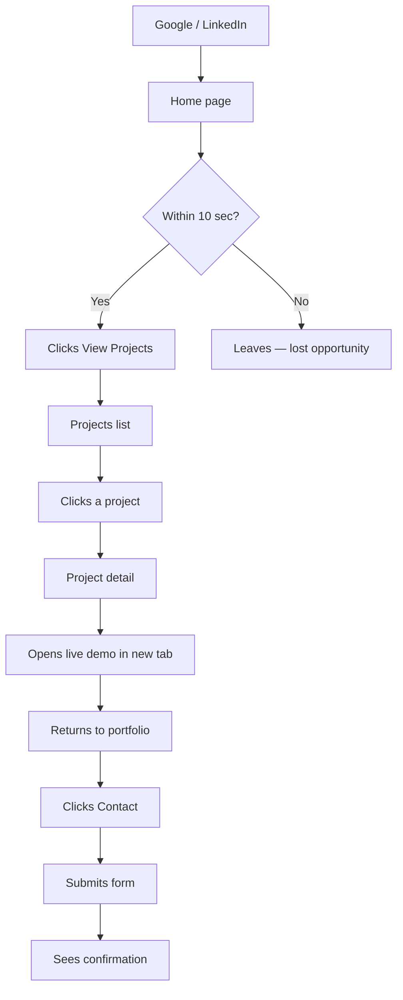
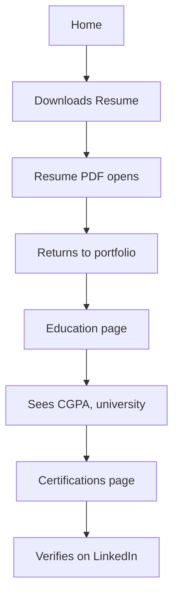
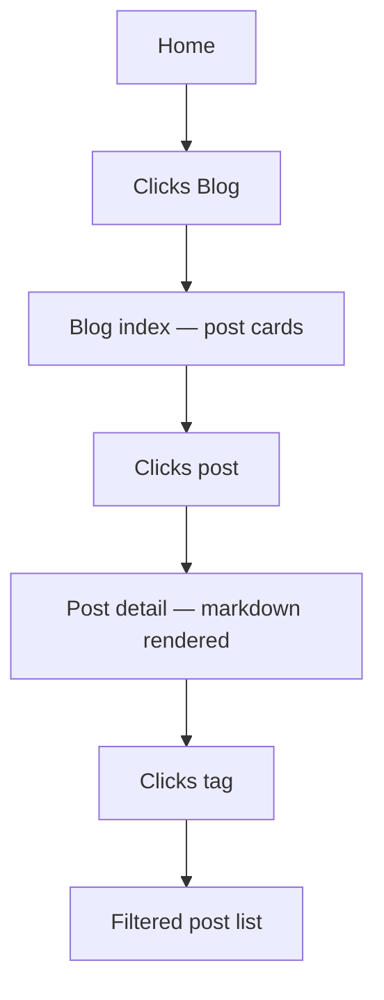

# Information Architecture

**Document:** 05-information-architecture.md
**Version:** 1.0
**Status:** Locked — Phase 1, Session 1
**Last Updated:** 2026-10-13

---

## 1. Purpose

This document defines the **structure** of the portfolio website — what pages exist, how users navigate between them, and what actions each page supports. It is the blueprint that all subsequent design and code work references.

---

## 2. Site Hierarchy

```
Portfolio Website
│
├── Public (Visitors)
│   ├── Home                /
│   ├── About               /about
│   ├── Projects            /projects
│   │   └── Project Detail  /projects/<slug>
│   ├── Education           /education
│   ├── Certifications      /certifications
│   ├── Resume              /resume
│   ├── Contact             /contact
│   ├── Blog (deferred)     /blog
│   │   └── Post Detail     /blog/<slug>
│   └── Error Pages         /404, /500
│
└── Admin (Owner Only — Authenticated)
    ├── Login               /admin/login
    ├── Logout              /admin/logout
    ├── Dashboard           /admin/
    ├── Profile             /admin/profile
    ├── Education           /admin/education
    ├── Semesters           /admin/semesters
    ├── Subjects            /admin/subjects
    ├── Skills              /admin/skills
    ├── Learning            /admin/learning
    ├── Projects            /admin/projects
    ├── Experience          /admin/experience
    ├── Certifications      /admin/certifications
    ├── Courses             /admin/courses
    ├── Blog                /admin/blog
    ├── Social Links        /admin/social-links
    └── Settings            /admin/settings
```

---

## 3. Public Routes — Detailed

### 3.1 Home — `/`

**Purpose:** First impression. Must communicate **who, what, credibility** in under 10 seconds.

**Sections:**
1. Hero — name, title, tagline, photo, hire badge (if enabled), primary CTA
2. Featured Projects — 4 cards with images, one-liner, tech stack, links
3. Skills Preview — top 6–8 skills with proficiency
4. Education Snapshot — university, degree, CGPA
5. Contact CTA — "Get in touch" button

**Hire badge:** Displayed on homepage hero only, controlled by `profile.available_for_hire` DB flag.

---

### 3.2 About — `/about`

**Purpose:** Humanize, tell the story, show trajectory.

**Sections:**
1. Long bio (~200 words)
2. Current focus (What I'm Working On)
3. Languages spoken
4. Currently Learning
5. Personal interests (optional)

---

### 3.3 Projects — `/projects`

**Purpose:** Full project catalog.

**Sections:**
1. Page header
2. Filter bar (by tech stack, category)
3. Grid of all projects (card = image, title, one-liner, tech tags)

**Filter behavior:** Client-side (JS) filtering. No page reload.

---

### 3.4 Project Detail — `/projects/<slug>`

**Purpose:** Deep dive on a single project.

**Sections:**
1. Title + one-liner + role + status
2. Live demo + GitHub buttons
3. Screenshots gallery
4. Full description
5. Tech stack
6. Key features
7. Challenges & solutions
8. Results / metrics
9. Related projects (links to 2–3 others)
10. Back to all projects

---

### 3.5 Education — `/education`

**Purpose:** Verify academic credentials.

**Sections:**
1. University + degree + department
2. Duration + expected graduation
3. **Overall CGPA** (prominent)
4. Semester-wise GPA (optional — toggle via DB)
5. Relevant courses list
6. FYP (once available)
7. Awards / scholarships (once available)

**Not displayed:** Subject-by-subject marks (stored in DB, admin-only).

---

### 3.6 Certifications — `/certifications`

**Purpose:** Show initiative and continuous learning.

**Sections:**
1. Certifications grid (issuer logo, title, date, verify link)
2. Courses grid (merged with certifications per project decision)
3. "Currently Learning" section

---

### 3.7 Resume — `/resume`

**Purpose:** Provide downloadable PDF.

**Sections:**
1. Preview of resume (embedded PDF viewer or image)
2. Download button (PDF)
3. Optionally: HTML summary of resume content

**File:** `static/files/resume.pdf` — updated manually when resume changes.

---

### 3.8 Contact — `/contact`

**Purpose:** Let visitors reach out without exposing email to scrapers.

**Sections:**
1. Contact form (name, email, subject, message) — CSRF-protected
2. Social links
3. Location (city-level only)
4. Response time expectation

**Backend:** Form submission sends email to owner + optional acknowledgment to sender.

---

### 3.9 Blog — `/blog` (Deferred)

**Purpose:** Long-form writing and SEO.

**Status:** Route not built in v1.0. Activated when first post is published via admin panel.

**When active:**
- `/blog` — paginated post list with tags
- `/blog/<slug>` — individual post
- `/blog/tag/<tag>` — filtered by tag

**DB:** `posts` table exists from V0.4. Admin panel can create/edit posts from V0.6.

---

### 3.10 Error Pages

| Route | Trigger |
|---|---|
| `/404` | Invalid URL |
| `/500` | Server error |

Both display: friendly message, "Back to home" button, site navbar/footer.

---

## 4. Admin Routes — Detailed

All admin routes require authentication. Unauthenticated access redirects to `/admin/login`.

### 4.1 Login — `/admin/login`
- Email + password form
- CSRF-protected
- SHA-256 (or bcrypt) password verification
- Rate-limited (Phase 5)

### 4.2 Dashboard — `/admin/`
- Counts: total projects, skills, certifications, posts, contact submissions
- Recent activity (last 5 edits)
- Quick links to all sections

### 4.3 Content Management
Each entity (projects, skills, certifications, etc.) has:
- **List view** — table with columns + Edit/Delete buttons
- **Create form** — empty form
- **Edit form** — pre-filled form
- **Delete confirmation** — modal

### 4.4 Profile — `/admin/profile`
- Edit name, title, tagline, short bio, long bio
- Upload/change photo
- **Toggle hire badge** (boolean flag)
- Edit contact info

### 4.5 Settings — `/admin/settings`
- Site title, meta description
- Google Analytics ID (if enabled)
- Social links management
- Password change

---

## 5. User Flows

### 5.1 Flow — Recruiter Evaluates Candidate



**Design implications:**
- Homepage hero must load fast (< 2s)
- Featured projects must be visible without scrolling on desktop
- Project cards must clearly show: image, title, one-liner, tech, live demo link

---

### 5.2 Flow — Hiring Manager Verifies Credentials



**Design implications:**
- Resume download must be one click
- CGPA must be prominent on Education page
- Certifications must link to verification URLs

---

### 5.3 Flow — Owner Updates Content

```mermaid
flowchart TD
    A[/admin/login] --> B[Enter credentials]
    B --> C{Valid?}
    C -->|No| A
    C -->|Yes| D[Dashboard]
    D --> E[Clicks Projects]
    E --> F[Project list]
    F --> G[Clicks Edit]
    G --> H[Edit form]
    H --> I[Save]
    I --> J[Flash: Project updated]
    J --> D
    D --> K[Logout]
```

**Design implications:**
- Login must be quick (single screen)
- Dashboard must show all sections at a glance
- Every CRUD action must give feedback (flash message)

---

### 5.4 Flow — Visitor Reads Blog (Future)



**Deferred until first post is published.**

---

## 6. Route Naming Conventions

| Convention | Rule | Examples |
|---|---|---|
| Lowercase | Always | `/projects` not `/Projects` |
| Hyphenated | Multi-word URLs | `/certifications` not `/certifications_page` |
| No trailing slash | Redirect if added | `/about` not `/about/` |
| Slugs for entities | URL-safe, unique | `/projects/car-price-prediction` |
| Admin prefix | `/admin/...` for all admin routes | `/admin/skills` |

**Slug generation rule:**
- Lowercase
- Hyphens for spaces
- Strip special characters
- Example: `"Car Price Prediction — End-to-End ML"` → `car-price-prediction-end-to-end-ml`

---

## 7. Navigation Structure

### 7.1 Primary Navbar (Public)

```
[Logo/Monogram]   Home   About   Projects   Education   Certifications   Contact   [Dark Mode Toggle]
```

**Rationale:**
- 6 top-level links max — matches user attention span
- Blog and Resume accessible via Home CTAs + footer (less prominent until content exists)
- Dark mode toggle always visible, top-right

### 7.2 Footer (Public)

**Three columns:**
1. **Navigation** — all pages (including Blog, Resume)
2. **Connect** — LinkedIn, GitHub, Kaggle, Email
3. **Legal** — License, Privacy (if applicable)

Bottom line: © 2026 Nadeem Ahmed Ghoto · Built with Flask

### 7.3 Admin Sidebar

**Grouped:**
- **Dashboard**
- **Profile** — Profile, Social Links, Settings
- **Content** — Education, Skills, Learning, Projects, Experience
- **Credentials** — Certifications, Courses
- **Blog** — Blog Posts
- **Logout**

---

## 8. Responsive Behavior

| Breakpoint | Behavior |
|---|---|
| **Mobile** (≤ 640px) | Hamburger menu, single-column layout, stacked cards |
| **Tablet** (641–1024px) | Hamburger or condensed nav, 2-column grids |
| **Desktop** (≥ 1025px) | Full navbar, 3–4 column grids |

**Touch targets:** Minimum 44×44px on mobile.
**Font scale:** Fluid via `clamp()`.

---

## 9. Design Phase Dependencies

This IA document drives:

| Phase | Deliverable | Depends On IA For |
|---|---|---|
| Session 2 | Use case + class diagrams | Actor definitions, entity list |
| Session 3 | DB schema | Route → data mapping |
| Session 4 | Wireframes | Page sections per route |
| Session 5 | Design system | Component inventory |
| Session 6 | Sequence + activity diagrams | User flows |

---

## 10. Out of Scope (v1.0)

These were considered and deferred:

| Feature | Reason |
|---|---|
| Multi-language (i18n) | English only for v1.0 |
| Comments on blog | Deferred to v2.x |
| Newsletter signup | Not needed |
| Guestbook | Not needed |
| Public transcript upload | Privacy |
| Phone number display | Privacy & spam |
| Native mobile app | Out of scope |

---

## 11. Future Extensibility

Routes and structure designed for easy addition of:

- `/testimonials` — v2.x (when real quotes exist)
- `/achievements` — v2.x (hackathons, awards)
- `/uses` — "what I use" page (popular in dev community)
- `/now` — "what I'm doing now" page (Derek Sivers style)
- Public API endpoints `/api/v1/...` — V0.8

Adding these should require **no refactor** — only a new blueprint + new admin section.

---

## 12. Change Log

| Date | Change |
|---|---|
| 2026-10-13 | Initial version — Phase 1, Session 1 |