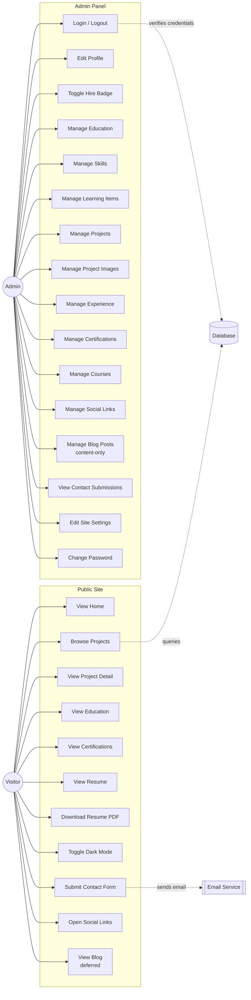
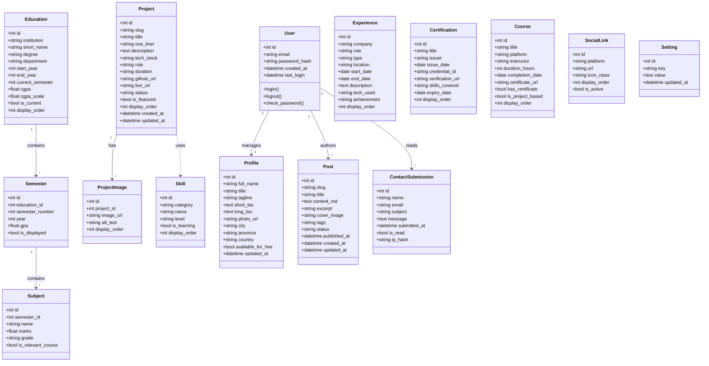
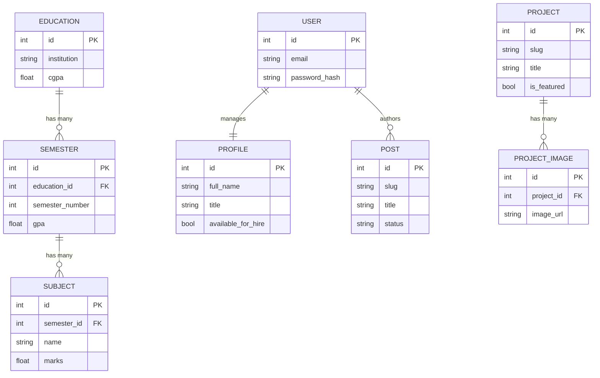

# UML Diagrams

**Document:** 06-uml-diagrams.md
**Version:** 1.0
**Status:** Locked — Phase 1, Session 2
**Last Updated:** 2026-10-13
**Tool:** Mermaid (text-based, renders on GitHub)

---

## 1. Purpose

This document contains the UML diagrams that define the structure and behavior of the portfolio website. All diagrams are written in **Mermaid** — a text-based diagramming syntax that renders natively on GitHub and is version-controlled alongside the code.

---

## 2. Actors

| Actor | Description | Access Level |
|---|---|---|
| **Visitor** | Any unauthenticated user — recruiters, professors, peers | Read-only public pages |
| **Admin** | Site owner (Nadeem Ahmed Ghoto) — authenticated | Full CRUD via admin panel |
| **System** | Automated processes — email sending, error handling | Internal only |

---

## 3. Use Case Diagram

**Notes:**
- `UC11` (Blog) is documented but **route not enabled in v1.0** — activated when first post is published.
- Contact form and login both touch the database.
- Email is a system-level actor — not shown as a human.

---

## 4. Entity Class Diagram

The following classes map to database tables. Relationships shown are 1-to-many unless noted.

**Notes:**
- `User` is the admin table — only one row in practice.
- `Profile` is a single-row table (id = 1 always).
- `Subject` records are stored but **not publicly displayed** — used only for internal tracking.
- `Post` exists in DB but public routes are deferred until first post is written.

---

## 5. Entity Relationship Overview

High-level view of how the 15 tables connect:

**Full column-level ERD to follow in `07-database-schema.md`.**

---

## 6. Table Inventory

| # | Table | Rows Expected | Public-Facing? |
|---|---|---|---|
| 1 | `users` | 1 | No |
| 2 | `profile` | 1 | Yes (read) |
| 3 | `education` | 1–3 | Yes |
| 4 | `semesters` | 8 | Partial (CGPA visible, GPA optional) |
| 5 | `subjects` | ~40 | No (private) |
| 6 | `skills` | 30+ | Yes |
| 7 | `projects` | 4–10 | Yes |
| 8 | `project_images` | 3–10 | Yes |
| 9 | `experience` | 0+ | Yes (when populated) |
| 10 | `certifications` | 2+ | Yes |
| 11 | `courses` | 2+ | Yes |
| 12 | `social_links` | 4–6 | Yes |
| 13 | `posts` | 0+ | Deferred |
| 14 | `contact_submissions` | 0+ | No (admin only) |
| 15 | `settings` | 5–10 | No |

**Total: 15 tables.**

---

## 7. Relationship Rules

| Parent | Child | Cardinality | On Delete |
|---|---|---|---|
| User → Profile | 1-to-1 | CASCADE |
| Education → Semester | 1-to-many | CASCADE |
| Semester → Subject | 1-to-many | CASCADE |
| Project → ProjectImage | 1-to-many | CASCADE |
| User → Post | 1-to-many | CASCADE |
| User → ContactSubmission | 1-to-many | SET NULL |

**CASCADE:** Deleting the parent removes all children.
**SET NULL:** Deleting the user doesn't delete submissions (audit trail).

---

## 8. Change Log

| Date | Change |
|---|---|
| 2026-10-13 | Initial version — Phase 1, Session 2 |