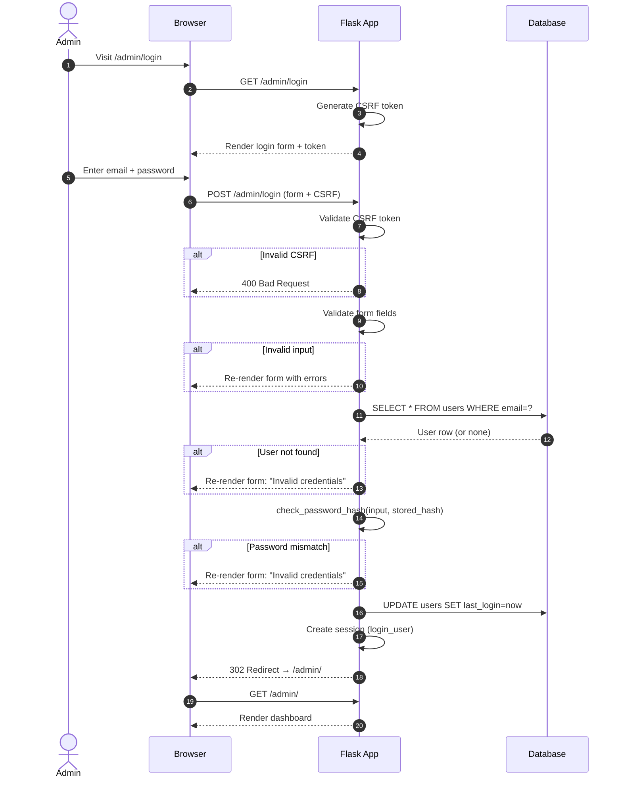
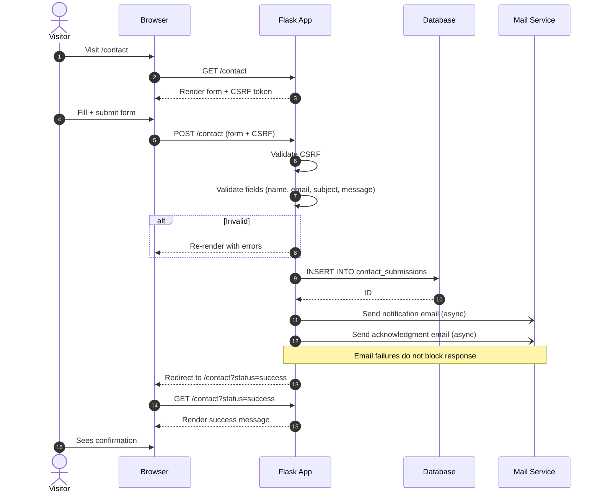
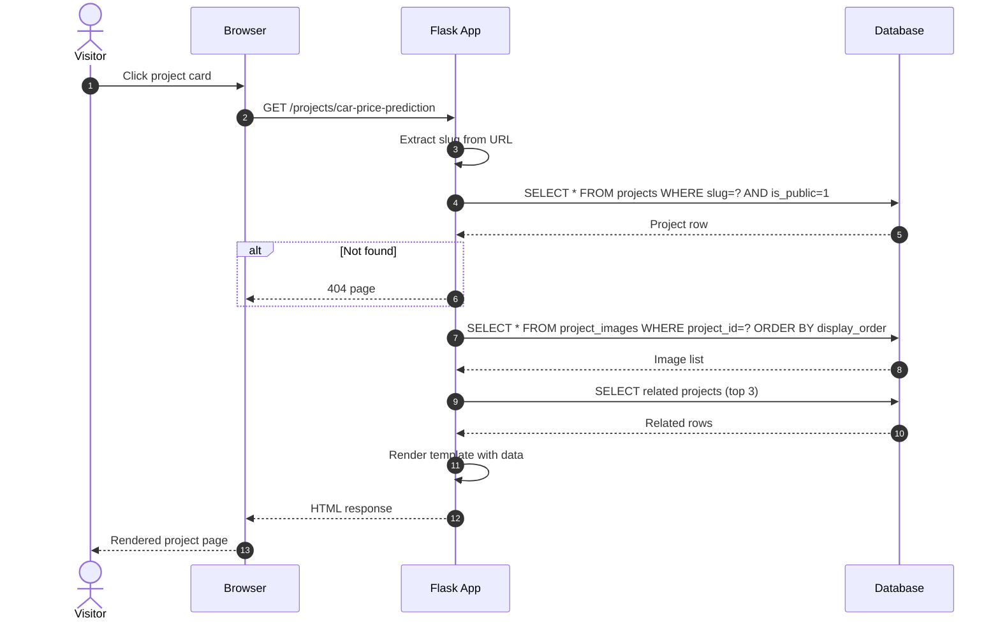
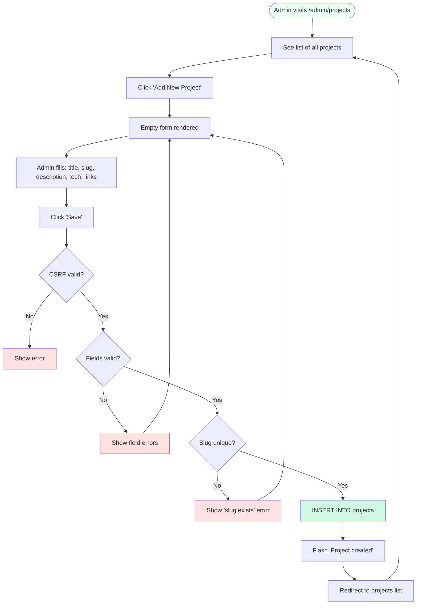
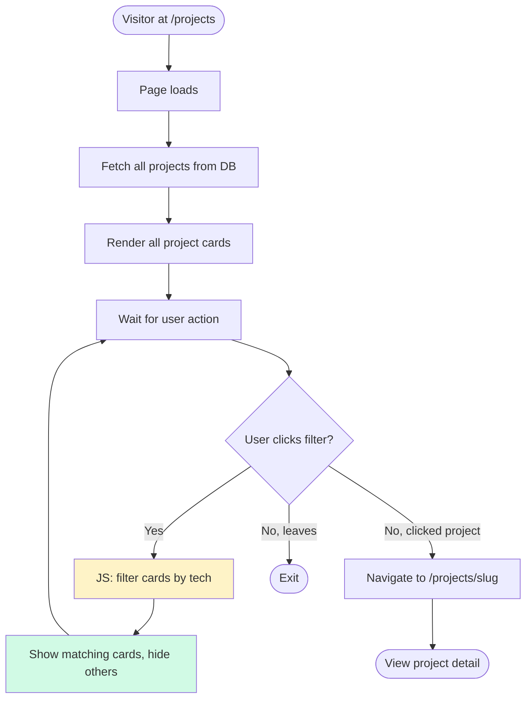
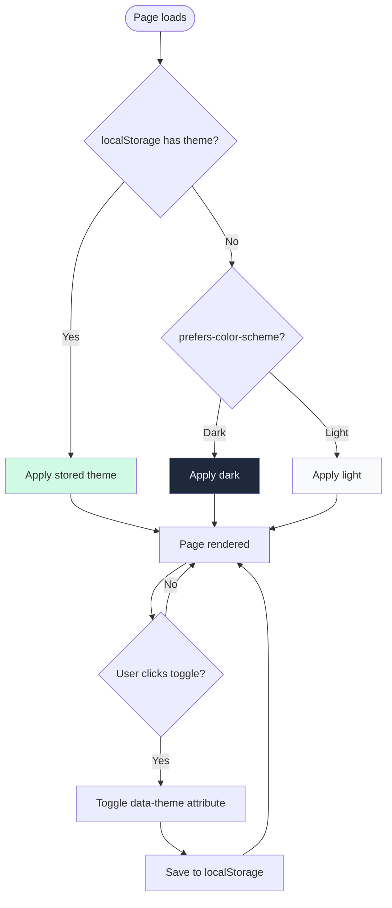
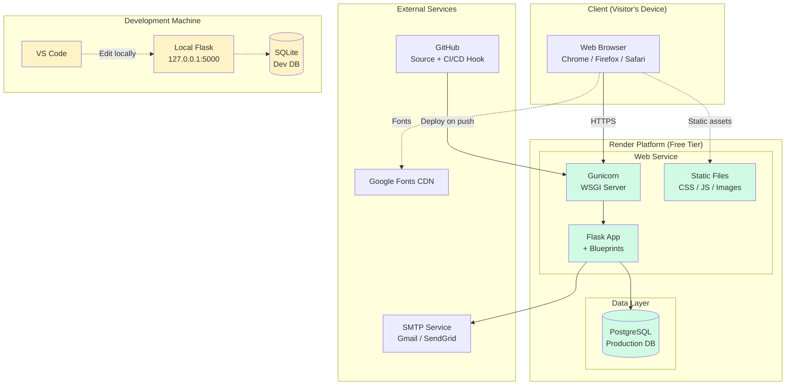

# Behavioral & Deployment Diagrams

**Document:** 11-behavioral-diagrams.md
**Version:** 1.0
**Status:** Locked — Phase 1, Session 6
**Last Updated:** 2026-10-13
**Tool:** Mermaid

---

## 1. Purpose

UML **structural** diagrams (use case, class, ER) were covered in document 06. This document covers **behavioral** diagrams — how the system *acts* over time — plus the **deployment** diagram that shows how the pieces fit together at runtime.

---

## 2. Sequence Diagrams

Sequence diagrams show **the flow of a single interaction** between actors and system components, ordered by time.

### 2.1 Admin Login Flow

**Notes:**
- **CSRF validation happens before** database queries.
- **Same error message** for "user not found" and "wrong password" — prevents username enumeration.
- **Session created server-side** using Flask-Login.

---

### 2.2 Contact Form Submission

**Notes:**
- `-)` denotes **asynchronous** call — email sending doesn't block the response.
- If email fails, the submission is still saved. Logged for review.
- Rate limiting applied (Phase 5).

---

### 2.3 Project Detail Fetch (Public)

**Notes:**
- **Three queries** for one page — but each is a simple indexed lookup. Fast.
- Could be optimized into a single join + subquery if needed later.
- **Related projects** add stickiness — visitor explores more.

---

## 3. Activity Diagrams

Activity diagrams show **the full flow of a multi-step process** with branching logic.

### 3.1 Admin Adds a New Project

**Notes:**
- **Three validation gates:** CSRF → field validation → slug uniqueness
- **Loop back to form** on any error — user's input preserved
- **Flash message** confirms success

---

### 3.2 Visitor Browses Projects with Filter

**Notes:**
- **Filter is client-side** — no server round-trip.
- Fast and smooth for ~10 projects; would need server-side for 100+.
- URL doesn't change (could use `?tech=python` for shareability later).

---

### 3.3 Toggle Dark Mode

**Notes:**
- **Priority:** stored preference → system preference → light default
- **Applied before render** to prevent flash of incorrect theme (FOUC)
- Script placed in `<head>` inline to avoid blocking

---

## 4. Deployment Diagram

Shows **where code runs**, from the visitor's browser to the database.

**Notes:**

| Component | Role |
|---|---|
| **Browser** | Renders HTML/CSS/JS, calls HTTPS |
| **Render** | Hosts production Flask app + PostgreSQL |
| **Gunicorn** | WSGI server — runs Flask workers |
| **Flask** | Application — routes, templates, business logic |
| **PostgreSQL** | Production database |
| **GitHub** | Source control + auto-deploy on push |
| **Google Fonts** | Font delivery via CDN |
| **Local machine** | Dev environment (SQLite, local Flask) |

**Deploy trigger:** Push to `main` → Render auto-builds → runs migrations → restarts Gunicorn.

---

## 5. Environment Comparison

| Aspect | Development | Production |
|---|---|---|
| **URL** | `127.0.0.1:5000` | `nadeemahmed.dev` (or Render subdomain) |
| **WSGI server** | Flask dev server | Gunicorn |
| **Database** | SQLite | PostgreSQL |
| **Debug mode** | `True` | `False` |
| **HTTPS** | No | Yes (auto by Render) |
| **Environment vars** | `.env` file | Render dashboard |
| **Static files** | Served by Flask | Served by Gunicorn / CDN |
| **Logs** | Console | Render logs dashboard |
| **Auto-deploy** | N/A | Push to `main` triggers |

**The app code is identical.** Only configuration differs — this is what "12-factor app" means.

---

## 6. Error Handling Flow

Not drawn as a diagram, but documented here as a sequence rule:

| Error Type | Where Handled | User Sees |
|---|---|---|
| **404 Not Found** | `@app.errorhandler(404)` | Custom 404 page |
| **500 Server Error** | `@app.errorhandler(500)` | Custom 500 page + logged |
| **CSRF failure** | Flask-WTF | 400 + flash "Session expired" |
| **Form validation** | Flask-WTF validators | Form re-rendered with errors |
| **DB connection lost** | Global error handler | 503 + retry message |
| **Email failure** | Try/except in mail helper | Silent — logged only |

**Principle:** Never show a stack trace to users. Log it, show a friendly page.

---

## 7. Performance Considerations

| Interaction | Target | Notes |
|---|---|---|
| Home page load | < 2s | Cached DB queries, minimized assets |
| Project detail | < 1.5s | Pre-loaded relations |
| Login | < 500ms | Single indexed query |
| Contact form submit | < 1s | Async email |
| Static asset load | < 200ms | CDN-cached on Render |

**Caching strategy (future):**
- Cache home page for 5 min (Flask-Caching)
- Invalidate on admin edit
- Static assets: 1-year cache header

**Not implemented in v1.0** — deferred to Phase 5.

---

## 8. Security Boundaries

| Boundary | Protection |
|---|---|
| **Browser → Server** | HTTPS (Render auto) |
| **Form submissions** | CSRF tokens (Flask-WTF) |
| **Passwords** | Werkzeug hashing (SHA-256 + salt) |
| **Admin routes** | `@login_required` decorator |
| **SQL injection** | SQLAlchemy parameterized queries |
| **XSS** | Jinja2 auto-escaping |
| **Secrets** | Environment variables (never in repo) |

---

## 9. Change Log

| Date | Change |
|---|---|
| 2026-10-13 | Initial version — Phase 1, Session 6 |